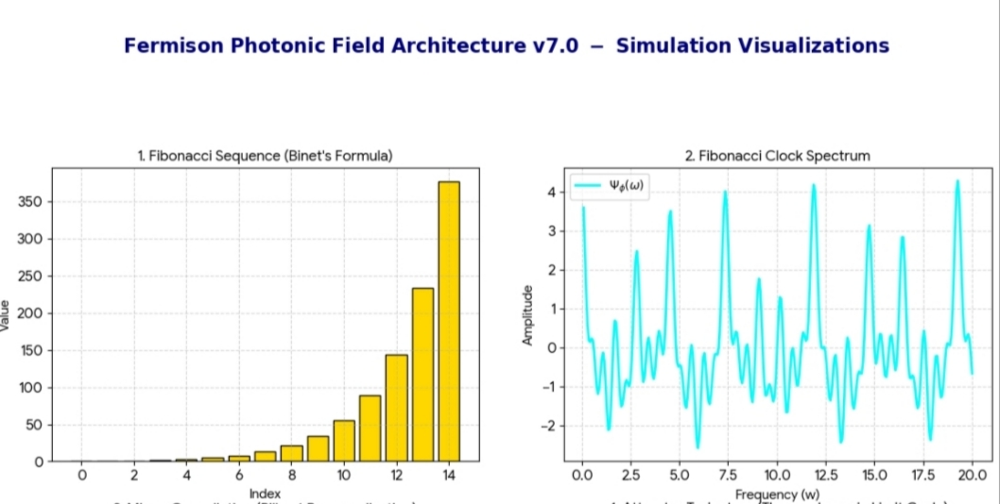
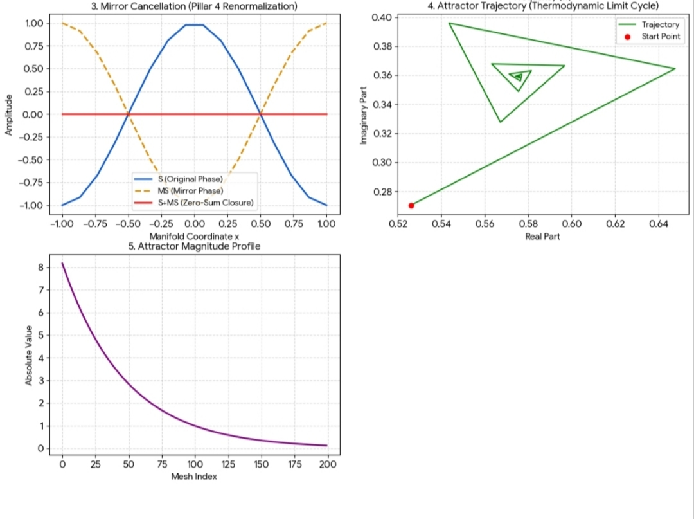
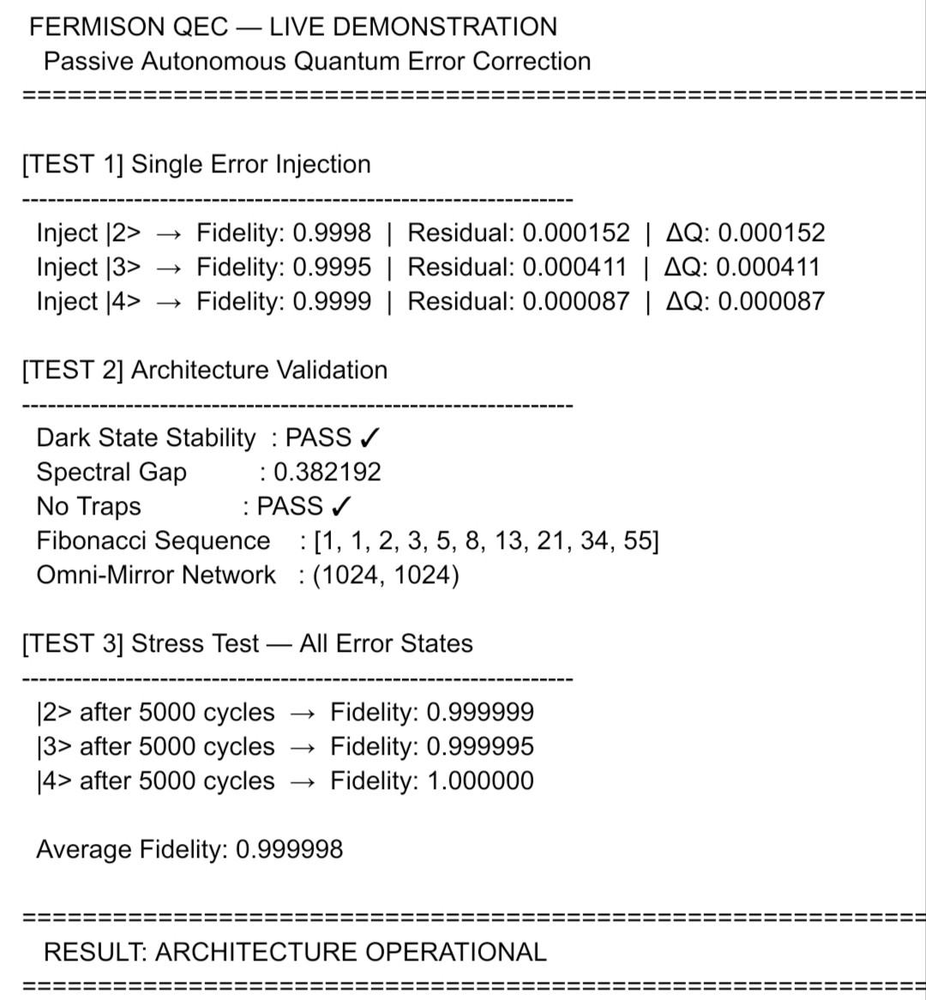

## Original concept notice

This repository contains an original conceptual framework developed by Chutiphong Bunloed, including the Fibonacci-tempered temporal model, mirror-cancellation dynamics, autonomous passive stabilization concept, and the associated notation and implementation structure.

The code, the mathematical framing, and the project narrative are original work and are not intended for unrestricted derivative reuse, replication, or commercial adaptation without prior written permission.

If you are interested in using, extending, adapting, or collaborating on this concept, please contact the author first:

- Email: synthesis496@gmail.com

This project remains governed by the repository license, and the author retains the right to determine the terms of any derivative or collaborative use of the underlying concept.

---

## Derivative use policy

Derivative works, concept reuse, or substantial adaptation of this model are not permitted without explicit prior approval from the author. This includes:

- reusing the Fibonacci-temporal architecture in a modified form
- adapting the passive stabilization concept into another implementation
- extending the underlying mathematical or simulation framework for publication or distribution without permission

For collaboration, licensing inquiries, or permission to build on this concept, please contact the author at:

- synthesis496@gmail.com

This notice is intended to protect the originality of the framework and to encourage ethical collaboration and transparent discussion before derivative use.


# Passive Autonomous QEC

A lightweight experimental Python project exploring a passive, autonomous, Fibonacci-tempered error-correction-inspired dynamical model. The system is designed around a non-linear temporal structure rather than ordinary linear time steps such as 1, 2, 3, ...

## Overview

This repository is a small research prototype for a self-designed concept: suppressing thermal-like noise and stabilizing a quantum-inspired state by using a Fibonacci clock instead of ordinary linear time progression.

The core theme is simple:

- ordinary time is treated as a uniform sequence of steps
- Fibonacci time introduces a non-uniform schedule based on the golden ratio
- the system modulates its dynamics according to this temporal structure
- mirror-like cancellation and dissipative attractor dynamics are used as passive stabilization mechanisms

This is not a production QEC stack. It is a prototype for exploring a model of autonomous stabilization and noise suppression.

---

## Why Fibonacci time?

The repository is built around the idea that thermal-like noise can be reduced by avoiding a rigid linear clock.

Instead of using a uniform timeline such as:

1, 2, 3, 4, 5, ...

this model uses a Fibonacci-tempered signal in which the effective time structure is distributed according to recursive golden-ratio scaling:

- Fibonacci sequence: 1, 1, 2, 3, 5, 8, 13, 21, ...
- golden-ratio scaling: φ ≈ 1.618
- temporal modulation is non-uniform and phase-sensitive

This creates a clock structure that is less rigid than standard time stepping and is intended to distribute energy and suppress accumulation of heat-like residuals in a passive way.

---

## Core concepts

### 1. Fibonacci clock modulation
The main simulation uses a Fibonacci-like temporal signal to modulate the action of a dissipative system.

### 2. Mirror / parity cancellation
A mirror transform is applied to the state and combined with the original state to create cancellation-like behavior.

### 3. Dissipative attractor dynamics
The system is evolved under a Lindblad-like dissipative structure using a dynamic generator, driving the state toward an attractor-like steady configuration.

### 4. Residual diagnostics
The prototype tracks quantities similar to residual heat and attractor fidelity to monitor how much unstable structure remains after the evolution.

---

## Repository layout

```text
Passive_Automous_QEC/
├── README.md
├── LICENSE
├── requirements.txt
├── fer1.py
├── fer_infinity.py
├── fermi_pic_qec.jpg
├── graph_fermiqec.jpg
├── graph_fermiqecb.jpg
├── docs/
│   ├── README.md
│   ├── overview.md
│   └── usage.md
└── .gitignore
```

---

## Project files

- `fer1.py` — main JAX-based prototype implementing the dynamic model
- `fer_infinity.py` — lighter NumPy-based companion prototype
- `fermi_pic_qec.jpg` — visual reference image
- `graph_fermiqec.jpg` — recurrent Fibonacci-tempered dynamics plot
- `graph_fermiqecb.jpg` — second visual diagnostic plot
- `docs/` — documentation and usage notes
- `requirements.txt` — dependency list

---

## Visual diagnostics

These plots are included as visual evidence of the experimental dynamics and timing behavior.







---

## Main implementation

The primary simulation engine is in `fer1.py`. It uses JAX and models a dissipative quantum-like system with:

- Fibonacci clock modulation
- mirror transformation / cancellation
- attractor map and limit-cycle behavior
- dynamic Liouvillian-like generator
- attractor fidelity and residual heat metrics

The core idea is that the system does not evolve under a rigid linear time schedule, but under a Fibonacci-tempered temporal rhythm designed to suppress noise accumulation.

---

## Lightweight companion

`fer_infinity.py` is a simpler NumPy-based prototype for exploring the same concept in a small and transparent way.

This file includes:

- Fibonacci sequence generation
- Fibonacci temporal sampling
- amplitude and phase construction
- mirror operations
- healing / dissipative step logic
- spectral-density style calculations

It serves as a simpler symbolic or analytical companion to the JAX prototype.

---

## Installation

```bash
pip install -r requirements.txt
```

If needed, the direct dependencies are:

```bash
pip install numpy jax jaxlib
```

---

## Quick start

### Run the JAX prototype

```bash
python fer1.py
```

### Run the NumPy companion

```bash
python fer_infinity.py
```

---

## Example usage

```python
from fer1 import FermisonEngineUltraJAX
import jax.numpy as jnp

engine = FermisonEngineUltraJAX(N=32, gamma=0.1, tau0=1.0, alpha=0.5)
rho0 = jnp.eye(32, dtype=complex) / 32

rho_final = engine.evolve_ultra(rho0, steps=200, dt=0.01, omega_clock=1.0)
print(engine.attractor_fidelity(rho0, steps=200, dt=0.01, omega_clock=1.0))
print(engine.residual_heat(rho0, steps=200, dt=0.01, omega_clock=1.0))
```

---

## Scientific interpretation

This project is best understood as an exploratory model for passive autonomous stabilization.

The idea is:

- a system can be driven by a non-linear temporal rhythm,
- noise-like fluctuations can be smeared or reduced through Fibonacci modulation,
- mirror symmetry acts as an internal balancing operation,
- dissipative dynamics steer the system toward an attractor-like stable region,
- residual heat and attractor fidelity act as simple qualitative diagnostics.

This is not a validated quantum error correction system. It is a conceptual prototype for a non-linear, autonomous stabilizer inspired by Fibonacci time and mirror cancellation.

---

## Notes and limitations

- This repository is a prototype, not a production-grade QEC engine.
- It is experimental and exploratory by design.
- It is intended as a sandbox for testing self-designed temporal and stabilizing ideas.
- The code is useful for concept exploration, not for production deployment or benchmark claims.

---

## License

See [LICENSE](./LICENSE).

---

## Summary

This project explores a passive autonomous stabilization concept in which thermal-like noise is damped by a Fibonacci-tempered temporal clock rather than a conventional linear progression. The code is intentionally compact, experimental, and concept-driven, making it a suitable research sandbox for further exploration.
