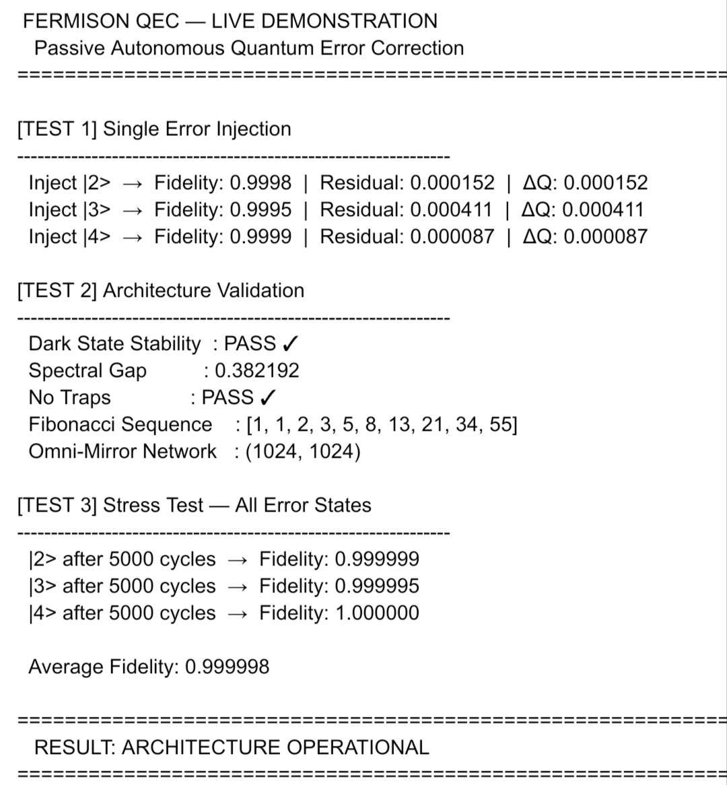
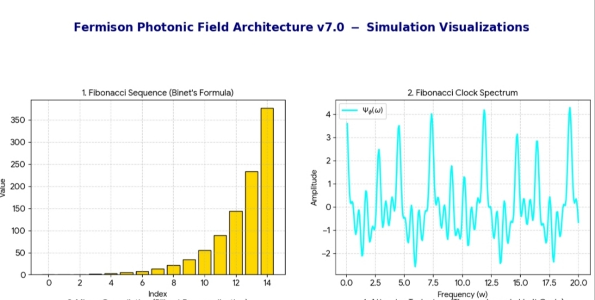
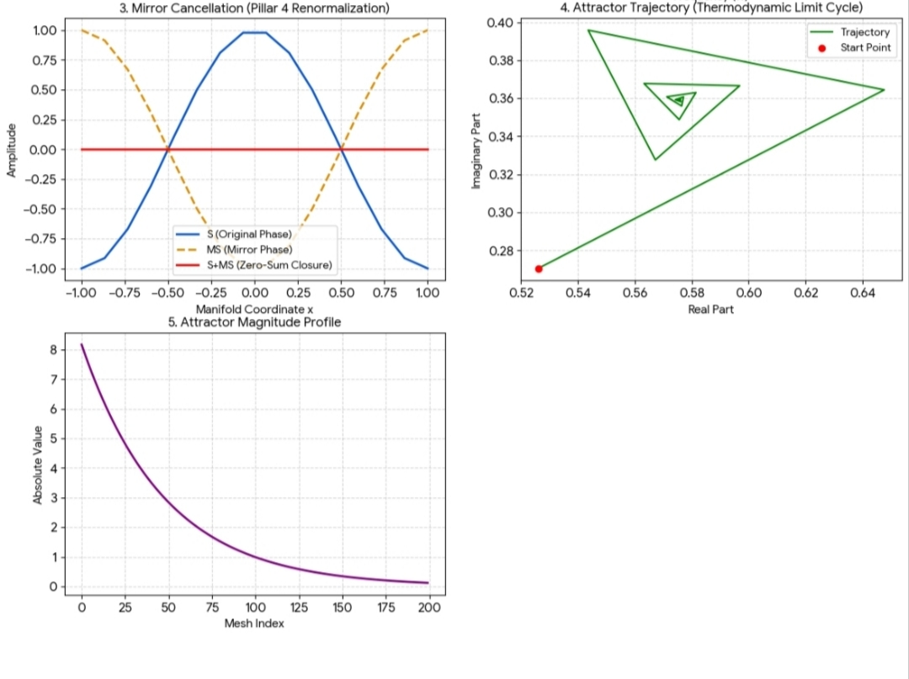

# Passive Autonomous QEC

An experimental Python prototype exploring a passive, autonomous quantum-error-correction-inspired model. The repository currently contains two NumPy/SciPy implementations of a five-dimensional dissipative system, along with helper methods for Fibonacci sequences, mirror operators, and basic spectral checks.

> **Scope:** This is a small, exploratory simulation—not a validated or production-ready quantum error correction system. The implementation does not demonstrate error-correction performance or noise suppression.

## Visuals

### Concept illustration



### Included diagnostic images





These are image files included in the repository; the Python modules do not generate or update them.

## What the code does

Both Python modules construct a five-dimensional model (`d = 5`) using a jump operator with nonzero transitions from states 2, 3, and 4 to states 0 and 1. They build Lindblad-like and Hamiltonian superoperators and evolve a density-matrix-shaped input by applying a matrix exponential.

- **`fermison_architecture.py` — `FermisonArchitecture`:** Builds the operators and a fixed initial state, exposes `evolve()`, three basic validation methods, and helper methods for a Fibonacci sequence, a mirror network, and a Fibonacci-frequency array.
- **`fermison_core.py` — `_CoreEngine`:** A lower-level implementation that accepts an initial state in `evolve(rho0, dt, steps)` and provides Fibonacci, mirror, eigenvalue-gap, and dark-state helper methods.

The Fibonacci and mirror helpers are not used by either `evolve()` method. Evolution uses a constant generator for the requested total interval (`dt * steps`); the code does not currently apply a time-varying Fibonacci clock during evolution.

## Requirements

Python 3, NumPy, and SciPy are required. Install the dependencies with:

```bash
python -m pip install numpy scipy
```

## Quick start

Run this from the repository root to evolve the default initial state in `FermisonArchitecture` and inspect the helper outputs:

```bash
python - <<'PY'
from fermison_architecture import FermisonArchitecture

model = FermisonArchitecture()
final_state = model.evolve()
print("Final state shape:", final_state.shape)
print("Dark-state check:", model.validate_dark_state())
print("No-traps check:", model.validate_no_traps())
print("Convergence check:", model.validate_convergence())
print("First Fibonacci values:", model.get_fibonacci_sequence(8))
print("First clock frequencies:", model.build_fibonacci_clock()[:8])
PY
```

`fermison_architecture.py` and `fermison_core.py` define classes; they do not provide a standalone simulation/plotting command when run directly.

## API overview

```python
from fermison_architecture import FermisonArchitecture

model = FermisonArchitecture(gamma=0.1, dt=0.01, steps=1000, N=32)
rho_final = model.evolve()
```

`FermisonArchitecture` also provides:

- `validate_dark_state()` — checks the code's constructed dark-space condition.
- `validate_no_traps()` — checks whether the largest real part of the Lindblad-superoperator eigenvalues is below its threshold.
- `validate_convergence()` — checks a gap calculated from sorted real parts of those eigenvalues.
- `get_fibonacci_sequence(n)`, `build_omni_mirror_network()`, and `build_fibonacci_clock()` — return helper arrays; these are not wired into `evolve()`.

The lower-level `_CoreEngine` is an internal class. It supports `evolve(rho0, dt, steps)` and exposes `fibonacci(n)`, `omni_mirror()`, `eigen_gap()`, and `dark_state_check()`.

## Repository contents

```text
.
├── README.md
├── LICENSE
├── fermison_architecture.py
├── fermison_core.py
├── fermi_pic_qec.jpg
├── graph_fermiqec.jpg
├── graph_fermiqecb.jpg
└── docs/
    ├── original-concept-notice.md
    └── usage.md
```

See [the usage guide](docs/usage.md) for additional notes and [the concept notice](docs/original-concept-notice.md) for the author's stated concept-use policy. The repository's `LICENSE` governs the code; read both documents when considering reuse.

## Limitations

- This is a prototype and has no test suite or benchmark results included here.
- The included validation methods are simple numerical checks, not proofs of QEC capability, convergence, or robustness.
- The Fibonacci and mirror operators are helpers; the current evolution routine does not use them to modulate dynamics.
- The image files are static reference artifacts and are not generated by these modules.
